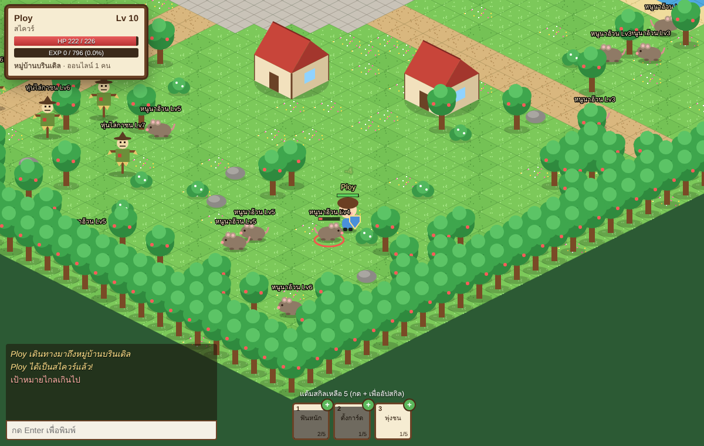

# Tales of Hearthvale

เกม MMORPG บนเบราว์เซอร์ แฟนตาซียุคกลางสีสดใส (งานอดิเรก ทำคนเดียว)
เอกสารออกแบบเกม (GDD): https://claude.ai/artifact/NEeNKY7apdeEkA9YQPh9fj



## ตอนนี้เล่นอะไรได้บ้าง (ขั้นที่ 1–2)

**ตัวละครและการบันทึก**
- สร้างตัวละครด้วยชื่อ + รหัสผ่าน แล้วเข้าเกมด้วยชื่อเดิมได้ทุกครั้ง
- เลเวล EXP อาชีพ สกิล และตำแหน่งถูกบันทึกในไฟล์ `server/data/hearthvale.db` (บันทึกตอนออกเกม เลเวลอัป และทุก 30 วินาที)

**การเล่น**
- **คลิกซ้าย** ที่พื้นเพื่อเดิน **คลิกที่มอนสเตอร์** เพื่อเดินไปตีอัตโนมัติ
- **ลากด้วยคลิกขวา** เพื่อมองไปรอบๆ
- กด **Enter** เพื่อแชต
- เลือดฟื้นเองเร็วเมื่อไม่ได้สู้ 5 วินาที ตายแล้วเสีย EXP 1% ของหลอด แล้วฟื้นที่ลานหมู่บ้าน
- ในหมู่บ้าน (รอบลานกลาง) มอนสเตอร์จะไม่ไล่ตาม

**มอนสเตอร์รอบหมู่บ้านบรินเดิล**

| มอนสเตอร์ | เลเวล | อยู่ที่ | นิสัย |
| --- | --- | --- | --- |
| ไก่แจ้หงอนไฟ | 1–3 | ทิศเหนือ | ไม่ตีก่อน |
| หนูนาอ้วน | 3–6 | ทิศตะวันออก | ไม่ตีก่อน |
| หุ่นไล่กาซน | 6–9 | ทิศใต้ | ตีก่อนถ้าเข้าใกล้ 4 ช่อง |
| แม่ไก่พิโรธ (บอส) | 12 | ในคอกล้อมรั้ว ทิศตะวันตกเฉียงใต้ | เกิดใหม่ทุก 5 นาที |

**อาชีพสไควร์ (Lv 10)**
- ถึง Lv 10 จะมีปุ่ม "เปลี่ยนอาชีพเป็นสไควร์" (เลือดและเกราะเพิ่ม)
- ได้แต้มสกิล 1 แต้มต่อเลเวล กด **+** บนช่องสกิลเพื่ออัป (สูงสุด 5 ขั้น)
- ใช้สกิลด้วยปุ่ม **1 2 3** หรือคลิกที่ช่องสกิล: **ฟันหนัก**, **ตั้งการ์ด** (ลดดาเมจที่รับ), **พุ่งชน** (พุ่งไปหาเป้าหมายและทำให้มึน)

ค่าตัวเลขทั้งหมด (มอนสเตอร์ จุดเกิด สกิล) อยู่ใน `shared/data/*.json` แก้แล้วรีสตาร์ทเซิร์ฟเวอร์ได้เลย
สูตรเลเวลและดาเมจอยู่ใน `shared/stats.ts`
ภาพทั้งหมดตอนนี้เป็นภาพชั่วคราวที่โค้ดวาดเอง (`client/src/textures.ts`, `client/src/monsterTextures.ts`)

## วิธีรันบนเครื่องตัวเอง

ต้องมี [Node.js](https://nodejs.org) เวอร์ชัน **22.13 ขึ้นไป** (ดาวน์โหลดแบบ LTS) เพราะใช้ฐานข้อมูล SQLite ที่มากับ Node
เช็กเวอร์ชันด้วย `node -v`

```bash
git clone https://github.com/yyahalloo12/hearthvale.git
cd hearthvale
npm install        # ครั้งแรกครั้งเดียว
npm run dev        # เปิดเซิร์ฟเวอร์ + หน้าเกม
```

แล้วเปิด http://localhost:5173 ในเบราว์เซอร์
อยากเห็นผู้เล่นหลายคน ให้เปิดอีกแท็บ (หรืออีกเบราว์เซอร์) แล้วใช้ชื่ออื่น

เพื่อนในวง Wi-Fi เดียวกันเข้าได้ที่ `http://<IP เครื่องคุณ>:5173`

อยากล้างตัวละครทั้งหมดแล้วเริ่มใหม่: ปิดเซิร์ฟเวอร์แล้วลบโฟลเดอร์ `server/data`

### คำสั่งอื่นๆ

| คำสั่ง | ทำอะไร |
| --- | --- |
| `npm run dev` | โหมดพัฒนา แก้โค้ดแล้วรีโหลดเอง |
| `npm start` | สร้างหน้าเกมแล้วเปิดแบบใช้งานจริงที่ http://localhost:2567 |
| `npm test` | รันเทสต์ (แผนที่ การหาเส้นทาง สูตร ล็อกอิน ตีมอนสเตอร์ และการบันทึก) |
| `npm run typecheck` | ตรวจ TypeScript |

## โครงสร้างโปรเจกต์

```
shared/        โค้ดที่ทั้งสองฝั่งใช้ร่วมกัน: แผนที่ การหาเส้นทาง สูตร ข้อความเครือข่าย
shared/data/   ข้อมูลเกม (JSON): มอนสเตอร์ จุดเกิด สกิล
server/        Node.js + Colyseus เซิร์ฟเวอร์เป็นผู้ตัดสินทุกอย่าง (20 ครั้งต่อวินาที) + SQLite
client/   Phaser 3 + Vite หน้าเกมบนเบราว์เซอร์ มุมมองเฉียง 2.5D
```

หลักสำคัญ: ผู้เล่นส่งแค่ "อยากเดินไปช่องนี้" "อยากตีตัวนี้" หรือ "อยากพูดว่าอะไร"
เซิร์ฟเวอร์คำนวณเส้นทางและตำแหน่งเอง หน้าเกมแค่วาดตามที่เซิร์ฟเวอร์บอก (กันโกง)

## ขั้นต่อไป (ตาม GDD 6.2)

1. ~~โลกที่มีชีวิต~~
2. ~~ต่อสู้และเลเวล~~ (สกิลตะโกนยั่วยุของสไควร์รอทำพร้อมระบบปาร์ตี้)
3. ต้นไม้พาสซีฟ
4. ไอเทมและคราฟต์
5. Hollow Zone
6. ตลาด
7. เติมเนื้อหา
