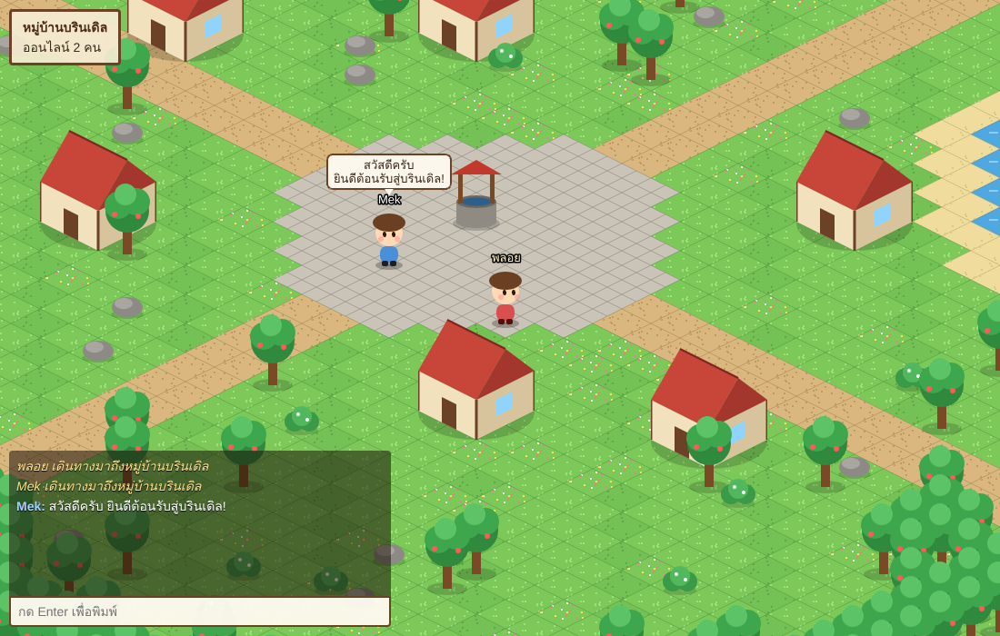

# Tales of Hearthvale

เกม MMORPG บนเบราว์เซอร์ แฟนตาซียุคกลางสีสดใส (งานอดิเรก ทำคนเดียว)
เอกสารออกแบบเกม (GDD): https://claude.ai/artifact/NEeNKY7apdeEkA9YQPh9fj



## ตอนนี้เล่นอะไรได้บ้าง (ขั้นที่ 1: โลกที่มีชีวิต)

- ตั้งชื่อตัวละครและเลือกสีเสื้อ แล้วเข้าสู่หมู่บ้านบรินเดิล
- **คลิกซ้าย** ที่พื้นเพื่อเดิน (เซิร์ฟเวอร์หาเส้นทางเลี่ยงต้นไม้ บ้าน และน้ำให้เอง)
- **ลากด้วยคลิกขวา** เพื่อมองไปรอบๆ คลิกเดินอีกครั้งกล้องจะกลับมาที่ตัวเรา
- เห็นผู้เล่นคนอื่นเดินไปมา พร้อมชื่อบนหัว
- กด **Enter** เพื่อพิมพ์แชต ข้อความขึ้นในกล่องแชตและเป็นบอลลูนบนหัว

ภาพทั้งหมดตอนนี้เป็นภาพชั่วคราวที่โค้ดวาดเอง (ไฟล์ `client/src/textures.ts`)

## วิธีรันบนเครื่องตัวเอง

ต้องมี [Node.js](https://nodejs.org) เวอร์ชัน 20 ขึ้นไป (ดาวน์โหลดแบบ LTS)

```bash
git clone https://github.com/yyahalloo12/hearthvale.git
cd hearthvale
npm install        # ครั้งแรกครั้งเดียว
npm run dev        # เปิดเซิร์ฟเวอร์ + หน้าเกม
```

แล้วเปิด http://localhost:5173 ในเบราว์เซอร์
อยากเห็นผู้เล่นหลายคน ให้เปิดอีกแท็บ (หรืออีกเบราว์เซอร์) แล้วใช้ชื่ออื่น

เพื่อนในวง Wi-Fi เดียวกันเข้าได้ที่ `http://<IP เครื่องคุณ>:5173`

### คำสั่งอื่นๆ

| คำสั่ง | ทำอะไร |
| --- | --- |
| `npm run dev` | โหมดพัฒนา แก้โค้ดแล้วรีโหลดเอง |
| `npm start` | สร้างหน้าเกมแล้วเปิดแบบใช้งานจริงที่ http://localhost:2567 |
| `npm test` | รันเทสต์ (แผนที่ การหาเส้นทาง ผู้เล่นสองคนเดินและแชต) |
| `npm run typecheck` | ตรวจ TypeScript |

## โครงสร้างโปรเจกต์

```
shared/   โค้ดที่ทั้งสองฝั่งใช้ร่วมกัน: แผนที่ การหาเส้นทาง ค่าคงที่ ข้อความเครือข่าย
server/   Node.js + Colyseus เซิร์ฟเวอร์เป็นผู้ตัดสินทุกอย่าง (20 ครั้งต่อวินาที)
client/   Phaser 3 + Vite หน้าเกมบนเบราว์เซอร์ มุมมองเฉียง 2.5D
```

หลักสำคัญ: ผู้เล่นส่งแค่ "อยากเดินไปช่องนี้" หรือ "อยากพูดว่าอะไร"
เซิร์ฟเวอร์คำนวณเส้นทางและตำแหน่งเอง หน้าเกมแค่วาดตามที่เซิร์ฟเวอร์บอก (กันโกง)

## ขั้นต่อไป (ตาม GDD 6.2)

1. ~~โลกที่มีชีวิต~~
2. ต่อสู้และเลเวล: มอนสเตอร์บรินเดิล EXP อาชีพสไควร์ + ฐานข้อมูล PostgreSQL เก็บตัวละคร
3. ต้นไม้พาสซีฟ
4. ไอเทมและคราฟต์
5. Hollow Zone
6. ตลาด
7. เติมเนื้อหา
