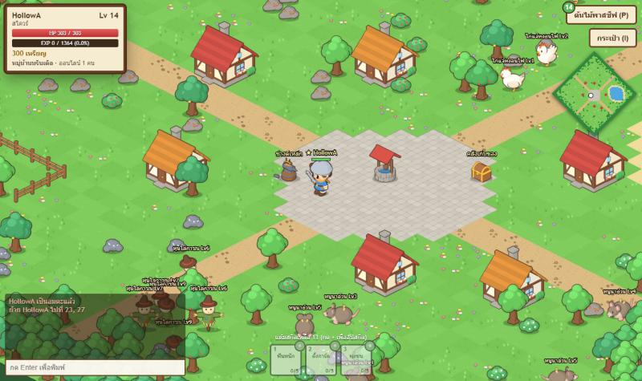
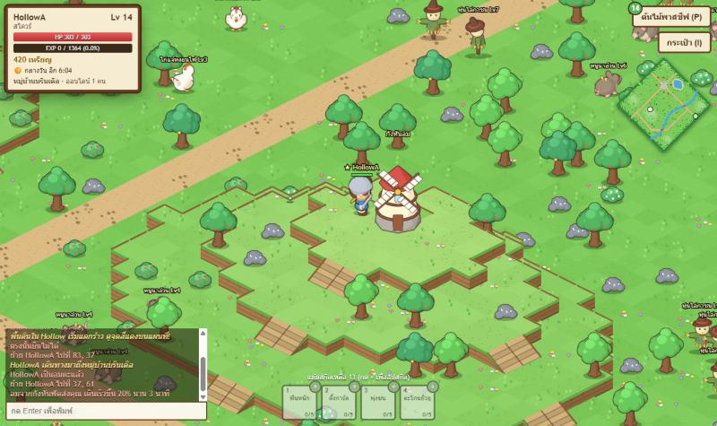
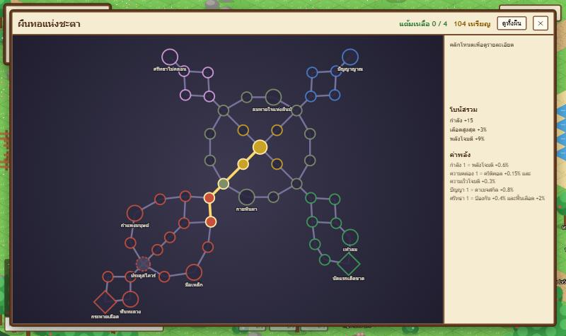
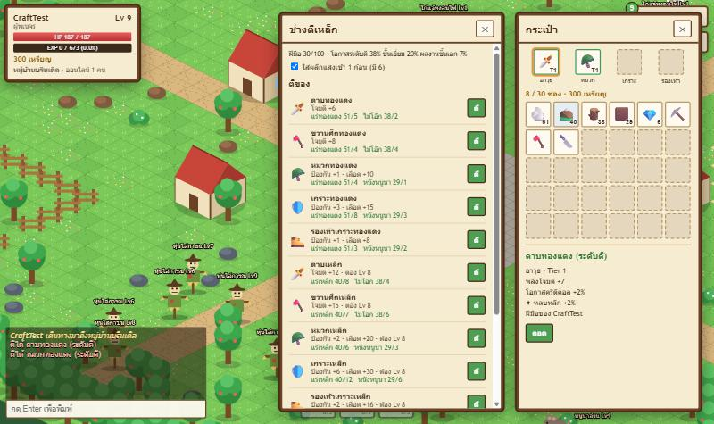
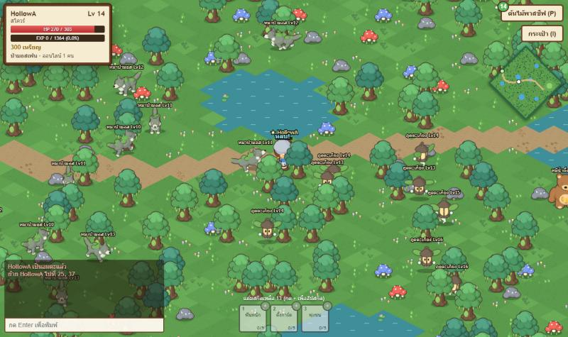
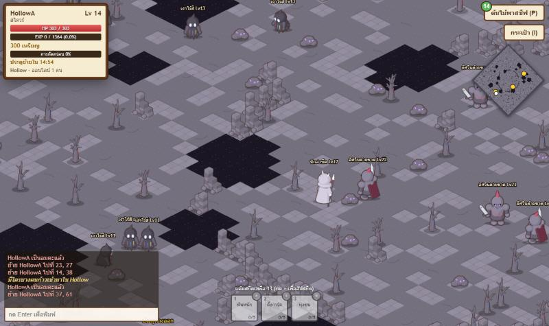
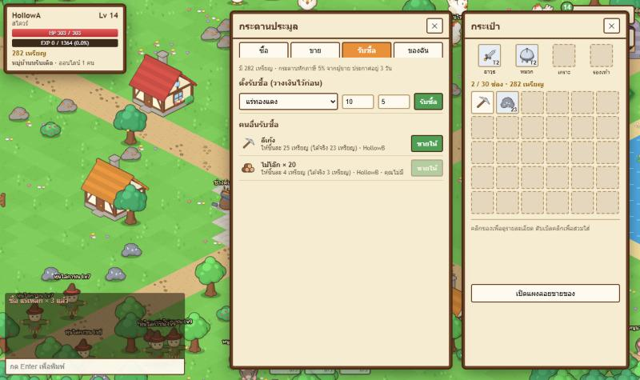

# Tales of Hearthvale

เกม MMORPG บนเบราว์เซอร์ แฟนตาซียุคกลางสีสดใส (งานอดิเรก ทำคนเดียว)
เอกสารออกแบบเกม (GDD): https://claude.ai/artifact/NEeNKY7apdeEkA9YQPh9fj



## ตอนนี้เล่นอะไรได้บ้าง (ขั้นที่ 1–6)

**ตัวละครและการบันทึก**
- สร้างตัวละครด้วยชื่อ + รหัสผ่าน แล้วเข้าเกมด้วยชื่อเดิมได้ทุกครั้ง
- เลเวล EXP อาชีพ สกิล โหนดพาสซีฟ เหรียญ ไอเทม และตำแหน่งถูกบันทึกในไฟล์ `server/data/hearthvale.db` (บันทึกตอนออกเกม เลเวลอัป และทุก 30 วินาที)

**การเล่น**
- **คลิกซ้าย** ที่พื้นเพื่อเดิน **คลิกที่มอนสเตอร์** เพื่อเดินไปตีอัตโนมัติ
- **ลากด้วยคลิกขวา** เพื่อมองไปรอบๆ
- กด **Enter** เพื่อแชต
- เลือดฟื้นเองเร็วเมื่อไม่ได้สู้ 5 วินาที ตายแล้วเสีย EXP 1% ของหลอด แล้วฟื้นที่ลานหมู่บ้าน
- ในหมู่บ้าน (รอบลานกลาง) มอนสเตอร์จะไม่ไล่ตาม

**แผนที่และลูกเล่น** (ทุกแผนที่ใหญ่ 3 เท่าของพื้นที่เดิม มีเนิน หน้าผา ทางลาด แม่น้ำ และสะพาน)



- ขึ้นลงต่างระดับได้ทางลาดเท่านั้น ตีประชิดข้ามหน้าผาไม่ได้ และหน้าผา บ้าน ซากกำแพงบังการยิงไกล
- **บรินเดิล:** กลางวัน 8 นาที กลางคืน 4 นาที กลางคืนหุ่นไล่กาให้ EXP และเหรียญ 1.5 เท่า กังหันลมบนเนิน (ทิศใต้) ให้เดินเร็วขึ้น 20% 3 นาที
- **ป่ามอสเฟน:** จุดโคมหิน 3 ต้นให้ครบใน 90 วินาที หมอกเปิดทางขึ้นลานสมบัติ 3 นาที เปิดหีบได้คนละครั้งต่อรอบ
- **Hollow:** พื้นบางจุดเตือนสีแดง 8 วินาทีแล้วถล่ม (เสียเลือด 40%) บ่อสีล้างการกัดกร่อนแต่ทุกคนเห็นคุณบนแผนที่

**พอร์ทัลหมอกและพอร์ทัลดำ** (บรินเดิลและมอสเฟน)

- พอร์ทัลเปิดเองแบบสุ่มทุก 3-6 นาที (มีพร้อมกันได้ 2 อัน) อยู่ 5 นาที เข้าได้รวม 7 คนไม่ว่าจะปาร์ตี้ไหน
- ระดับ ธรรมดา/หายาก/หายากมาก/ตำนาน ยิ่งหายากยิ่งมีระลอกมอนสเตอร์มากและแรงขึ้น (หายากมากขึ้นไปมีบอส) และหีบรางวัลยิ่งดี
- ข้างในเป็นเกาะของตัวเอง 10 นาที ปราบครบทุกระลอกแล้วเปิดหีบกลางเกาะได้คนละครั้ง เดินกลับทางเข้าเพื่อออก
- พอร์ทัลดำ (Lv 10+): คนนอกปาร์ตี้ตีกันได้และตายแล้วของตกหมด แต่รางวัลเป็นสองเท่า
- GM: /portal 0-3 เปิดพอร์ทัลข้างตัว, /portal 2 dark เปิดพอร์ทัลดำ

**ดันเจี้ยน** (ประตูถาวร)

- ห้องใต้ดินกังหันลม (บรินเดิล 20,60 · Lv 5+) และถ้ำรากไม้เก่า (มอสเฟน 96,22 · Lv 14+)
- ปาร์ตี้เดียวกันเข้าดันเจี้ยนรอบเดียวกัน สูงสุด 5 คน ปราบทีละห้อง ประตูถัดไปเปิดเอง ห้องสุดท้ายมีบอสและหีบรางวัล มีเวลา 20 นาที

**บอสโลกและอีเวนต์** (บรินเดิลและมอสเฟน)

- บอสโลกตื่นทุก 30 นาที (เตือนก่อน 1 นาที): ราชาหุ่นไล่กา (Lv 20) ในบรินเดิล จ้าวหมีรวงผึ้ง (Lv 30) ในมอสเฟน เลือดเพิ่มตามจำนวนคนในแผนที่ ทุกคนที่ตีได้อย่างน้อย 1% ของเลือดได้รางวัล ถ้าไม่มีใครปราบใน 10 นาทีจะกลับไปหลับ
- อีเวนต์ 5 นาที ทุก 8-14 นาที: ชั่วโมงทอง (เก็บของได้สองเท่า) หรือ ฝูงบุก (มอนสเตอร์ฝูงใหญ่ ฆ่าได้ EXP ×1.5)
- GM: /event golden, /event swarm, /event boss

**ปาร์ตี้** (สูงสุด 5 คน กด O หรือพิมพ์ /invite ชื่อ)

- แชทปาร์ตี้ /p ข้อความ ใช้ได้ข้ามแผนที่ ชื่อเพื่อนเป็นสีเขียว และเห็นเป็นจุดเขียวบนมินิแมพ
- ฆ่ามอนสเตอร์แล้วเพื่อนที่อยู่ห่างไม่เกิน 12 ช่องแบ่ง EXP และเหรียญ (รวมได้มากขึ้นคนละ 10%)
- ใน Hollow คนในปาร์ตี้ตีกันไม่ได้ และฮีล พร ชุบชีวิตใช้กับเพื่อนได้
- ชานหมู่บ้าน ทางเข้าป่า และลานไม้เงียบเป็นที่สงบ มอนสเตอร์ไม่เข้ามา เหมาะเก็บของ

**มอนสเตอร์รอบหมู่บ้านบรินเดิล**

| มอนสเตอร์ | เลเวล | อยู่ที่ | นิสัย |
| --- | --- | --- | --- |
| ไก่แจ้หงอนไฟ | 1–3 | ทิศเหนือ | ไม่ตีก่อน |
| หนูนาอ้วน | 3–6 | ทิศตะวันออก | ไม่ตีก่อน |
| หุ่นไล่กาซน | 6–9 | ทิศใต้ | ตีก่อนถ้าเข้าใกล้ 4 ช่อง |
| แม่ไก่พิโรธ (บอส) | 12 | ในคอกล้อมรั้ว ทิศตะวันตกเฉียงใต้ | เกิดใหม่ทุก 5 นาที |

**อาชีพ (เลือกที่ Lv 10)**

| อาชีพ | จุดเด่น | สกิล 1–4 |
| --- | --- | --- |
| สไควร์ | ประชิด เลือดและเกราะสูง | ฟันหนัก, ตั้งการ์ด, พุ่งชน, ตะโกนยั่วยุ |
| นักธนู | ยิงไกล คริติคอล | ยิงคู่, ลูกศรเจาะ, กระโดดถอย, มาร์กจุดอ่อน |
| นักทอเวท | เวทหลายเป้า ใช้มานา | ลูกไฟ, หอกน้ำแข็ง, สายฟ้าลูกโซ่, โล่มานา |
| อาโคไลต์ | รักษาและคุ้มกัน ใช้มานา | แสงลงทัณฑ์, รักษา, พรคุ้มกัน, ชุบชีวิต |

- นักธนู นักทอเวท และอาโคไลต์ได้อาวุธชิ้นแรกฟรี อาวุธใช้ได้เฉพาะอาชีพ ชุดใส่ได้ทุกอาชีพ
- อาโคไลต์คลิกผู้เล่นอื่นเพื่อเลือกคนที่จะรักษา (ใน Hollow รักษาได้เฉพาะตัวเอง)
- งานช่าง 3 สายที่ทั่งเดียวกัน: ตีเหล็ก งานไม้ (ธนู คทา) หนังและผ้า เกี่ยวใบหอมจากพุ่มไม้และเห็ดเรืองในป่าด้วยเคียว
- ได้แต้มสกิล 1 แต้มต่อเลเวล กด **+** บนช่องสกิลเพื่ออัป (สูงสุด 5 ขั้น)
- ใช้สกิลด้วยปุ่ม **1 2 3 4** หรือคลิกที่ช่องสกิล

**ต้นไม้พาสซีฟ "ผืนทอแห่งชะตา"** (กดปุ่ม **P** หรือปุ่มมุมขวาบน)



- ชุดแรก 50 โหนด: เล็ก 40 เด่น 8 หลัก 2 (กระหายเลือด และนัดแรกเด็ดขาด)
- ได้ 1 แต้มต่อเลเวล คลิกโหนดที่ติดกับโหนดที่เรียนแล้ว แล้วกด "เรียนโหนดนี้"
- ทุกคนเริ่มจากกลางต้นไม้ เมื่อเป็นสไควร์จะเริ่มจาก "ประตูสไควร์" ได้อีกจุด (4 โหนดหลังประตูเปิดได้เฉพาะสไควร์)
- มอนสเตอร์ดรอปเหรียญ ใช้ล้างโหนดทีละโหนด ราคา 10 เหรียญ × เลเวล ล้างระหว่างต่อสู้ไม่ได้
- ลากเพื่อเลื่อน หมุนล้อเมาส์เพื่อซูม

**ไอเทมและคราฟต์** (กดปุ่ม **I** เพื่อเปิดกระเป๋า)



- **ช่างตีเหล็ก** (ทั่งที่ลานหมู่บ้าน): ซื้ออีเก้ง ขวานตัดไม้ มีดแล่ (15 เหรียญ) ตีอาวุธและเกราะหนัก Tier 1–2 และขายของ
- **เก็บวัตถุดิบ:** คลิกก้อนหินเพื่อขุดแร่ (ทางใต้เป็นแร่เหล็ก) คลิกต้นไม้เพื่อตัดไม้ ต้องมีเครื่องมือในกระเป๋า
- **ดรอป:** หนูนาให้หนังถ้าพกมีดแล่ หุ่นไล่กาให้ไม้ แม่ไก่พิโรธให้แร่เหล็กและผลึก ผลึกแสงเช้าดรอปนานๆ ครั้ง
- **คุณภาพ:** ปกติ ระดับดี ชั้นเยี่ยม ผลงานชิ้นเอก ยิ่งดียิ่งแรงและได้ค่าพิเศษสุ่ม 1–3 อย่าง ฝีมือช่างและผลึกเพิ่มโอกาส ของสลักชื่อคนตี
- **คลังเก็บของ** (หีบที่ลานหมู่บ้าน) 80 ช่อง กระเป๋า 30 ช่อง
- อาวุธและหมวกที่สวมเห็นบนตัวละคร

**ป่ามอสเฟน** (Lv 10–20 เดินผ่านซุ้มไม้สุดถนนทิศตะวันออก)



- หมาป่ามอส (10–13 ตีก่อน) ภูตตะเกียง (13–16) หมีน้ำผึ้ง (16–20 ตีก่อน) และบอสต้นไม้เฒ่าผู้หลับใหล (Lv 22 ในทุ่งดอกไม้สุดทางเดิน)
- ตัดไม้มอส ขุดแร่เหล็ก และได้หนังหมาป่าถ้าพกมีดแล่
- ตายแล้วเสีย EXP 1% และฟื้นที่หมู่บ้าน เดินกลับซุ้มไม้ทิศตะวันตกเพื่อออก

**Hollow Zone** (ประตูม่วงสุดถนนทิศเหนือ ต้องเลเวล 10)



- **PvP:** คลิกผู้เล่นคนอื่นเพื่อโจมตี เข้ามาใหม่มีเกราะกันดาเมจ 5 วินาที
- **ตาย = ห่อสมบัติ:** ของที่สวมและของในกระเป๋าตกทั้งหมด 30% ถูกทำลาย ใครก็เก็บได้ 5 นาที เหรียญและของในคลังปลอดภัย
- **ทางออก:** ประตูทอง 3 จุด ย้ายที่ทุก 15 นาที เห็นบนแผนที่ย่อ
- **ค่าการกัดกร่อน:** เพิ่มนาทีละ 5 ทำให้มีโอกาสดรอปดีขึ้น (สูงสุด 2 เท่า) เกิน 50 แล้วทุกคนเห็นคุณบนแผนที่ รีเซ็ตเมื่อออก
- **ล็อกเอาต์:** ตัวละครค้างอยู่ 30 วินาที กลับเข้ามาในช่วงนั้นได้ร่างเดิม
- **มอนสเตอร์:** เงาไร้สี (10–14) นักล่าซีดที่เดินตรวจตรา (15–18) อัศวินด้ายขาดในวงใน (18–22)
- **ของ Tier 3:** แร่หมอก ไม้ไร้สี ด้ายชะตาขาด ใช้ตีชุดหมอกที่ช่างตีเหล็ก (ฝีมือ 35)
- ช่วงทดสอบ: เข้าได้ที่ Lv 10 และดรอป Tier 3 (GDD คือ Lv 30 และ Tier 5–6) เพราะพื้นที่เลเวล 10–30 อยู่ในขั้นที่ 7 แก้ได้ใน `shared/hollow.ts`

**ตลาด** (กระดานประมูลที่ลานหมู่บ้าน และแผงลอย)



- **กระดานประมูล:** ตั้งขาย ซื้อบางส่วน ตั้งรับซื้อ (วางเงินไว้ก่อน) ผู้ขายเสียภาษี 5% ประกาศอยู่ 3 วัน หมดเวลาแล้วของหรือเงินกลับไปที่ "รอรับ"
- **แผงลอย:** เปิดจากกระเป๋า ในหมู่บ้านเท่านั้น สูงสุด 12 รายการ ไม่เสียภาษี อยู่ได้ 12 ชั่วโมงแม้ออกจากเกม
- เงินจากการขายเข้ากระเป๋าเอง ถ้าออฟไลน์จะได้ตอนเข้าเกม
- ทุกการซื้อขายบันทึกเป็นชุดเดียวในฐานข้อมูล ของไม่งอกและไม่หาย

ค่าตัวเลขทั้งหมด (มอนสเตอร์ จุดเกิด สกิล โหนดพาสซีฟ ไอเทม สูตรคราฟต์) อยู่ใน `shared/data/*.json` แก้แล้วรีสตาร์ทเซิร์ฟเวอร์ได้เลย
สูตรเลเวลและดาเมจอยู่ใน `shared/stats.ts` กติกาต้นไม้อยู่ใน `shared/passives.ts` กติกาไอเทมอยู่ใน `shared/items.ts` กติกา Hollow อยู่ใน `shared/hollow.ts`
ตัวละคร มอนสเตอร์ และฉากปั้นและเรนเดอร์จาก Blender (สคริปต์อยู่ใน `art/` ภาพอยู่ใน `client/public/art/` วิธีเรนเดอร์ใหม่อยู่ใน `art/README.md`)
สีพื้นใต้รายละเอียดยังวาดด้วยโค้ด (`client/src/textures.ts`)

## วิธีรันบนเครื่องตัวเอง

ต้องมี [Node.js](https://nodejs.org) เวอร์ชัน **22.13 ขึ้นไป** (ดาวน์โหลดแบบ LTS) เพราะใช้ฐานข้อมูล SQLite ที่มากับ Node
เช็กเวอร์ชันด้วย `node -v`

```bash
git clone https://github.com/yyahalloo12/hearthvale.git
cd hearthvale
npm install        # ครั้งแรกครั้งเดียว
npm run dev        # เปิดเซิร์ฟเวอร์ + หน้าเกม
```

แล้วเปิด http://localhost:5173 ในเบราว์เซอร์
อยากเห็นผู้เล่นหลายคน ให้เปิดอีกแท็บ (หรืออีกเบราว์เซอร์) แล้วใช้ชื่ออื่น

เพื่อนในวง Wi-Fi เดียวกันเข้าได้ที่ `http://<IP เครื่องคุณ>:5173`

อยากล้างตัวละครทั้งหมดแล้วเริ่มใหม่: ปิดเซิร์ฟเวอร์แล้วลบโฟลเดอร์ `server/data`

### แอดมิน (GM)

ตั้งได้จากเครื่องที่รันเซิร์ฟเวอร์เท่านั้น ให้สิทธิ์จากในเกมไม่ได้

```bash
npm run admin -- ชื่อตัวละคร        # ตั้งเป็นแอดมิน
npm run admin -- ชื่อตัวละคร off    # ยกเลิก
npm run admin                       # ดูรายชื่อ
```

เข้าเกมใหม่แล้วพิมพ์ในแชต เช่น `/help` `/level 20` `/gold 1000` `/give sword_2 1 3` `/god` `/tp 24 24` `/hollow` `/spawn hen 3` `/kick @ชื่อ`
คำสั่งไม่แสดงให้คนอื่นเห็น และถูกบันทึกในหน้าต่างเซิร์ฟเวอร์ ชื่อแอดมินมีดาวนำหน้า ใช้รหัสผ่านที่เดายากกับบัญชีแอดมิน

### คำสั่งอื่นๆ

| คำสั่ง | ทำอะไร |
| --- | --- |
| `npm run dev` | โหมดพัฒนา แก้โค้ดแล้วรีโหลดเอง |
| `npm start` | สร้างหน้าเกมแล้วเปิดแบบใช้งานจริงที่ http://localhost:2567 |
| `npm test` | รันเทสต์ (แผนที่ การหาเส้นทาง สูตร ล็อกอิน ตีมอนสเตอร์ และการบันทึก) |
| `npm run admin` | ตั้งหรือยกเลิกแอดมิน |
| `npm run typecheck` | ตรวจ TypeScript |

## โครงสร้างโปรเจกต์

```
shared/        โค้ดที่ทั้งสองฝั่งใช้ร่วมกัน: แผนที่ การหาเส้นทาง สูตร ข้อความเครือข่าย
shared/data/   ข้อมูลเกม (JSON): มอนสเตอร์ จุดเกิด สกิล
server/        Node.js + Colyseus เซิร์ฟเวอร์เป็นผู้ตัดสินทุกอย่าง (20 ครั้งต่อวินาที) + SQLite
client/   Phaser 3 + Vite หน้าเกมบนเบราว์เซอร์ มุมมองเฉียง 2.5D
```

หลักสำคัญ: ผู้เล่นส่งแค่ "อยากเดินไปช่องนี้" "อยากตีตัวนี้" หรือ "อยากพูดว่าอะไร"
เซิร์ฟเวอร์คำนวณเส้นทางและตำแหน่งเอง หน้าเกมแค่วาดตามที่เซิร์ฟเวอร์บอก (กันโกง)

## ขั้นต่อไป (ตาม GDD 6.2)

1. ~~โลกที่มีชีวิต~~
2. ~~ต่อสู้และเลเวล~~ (สกิลตะโกนยั่วยุของสไควร์รอทำพร้อมระบบปาร์ตี้)
3. ~~ต้นไม้พาสซีฟ~~ (โหนดหลักที่ต้องใช้ปาร์ตี้ มานา หรือเกราะ รอทำพร้อมระบบนั้น)
4. ~~ไอเทมและคราฟต์~~ (ความทนทาน ค่าซ่อม สมุนไพร และช่างสายอื่นยังไม่ได้ทำ)
5. ~~Hollow Zone~~ (อีเวนต์ตามเวลา บอสโลก และปาร์ตี้ยังไม่ได้ทำ)
6. ~~ตลาด~~ (กระดานจะย้ายไปเมืองหลวงเมื่อทำแผนที่นั้น)
7. เติมเนื้อหา
